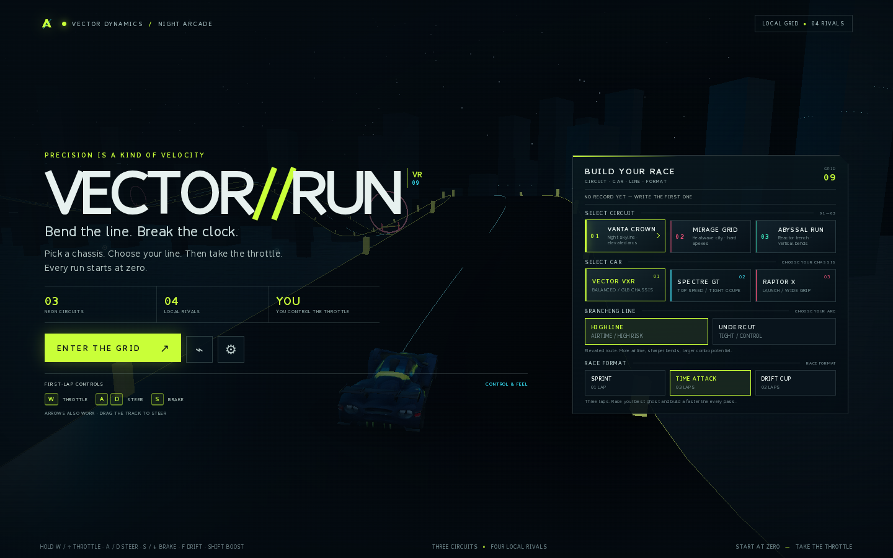
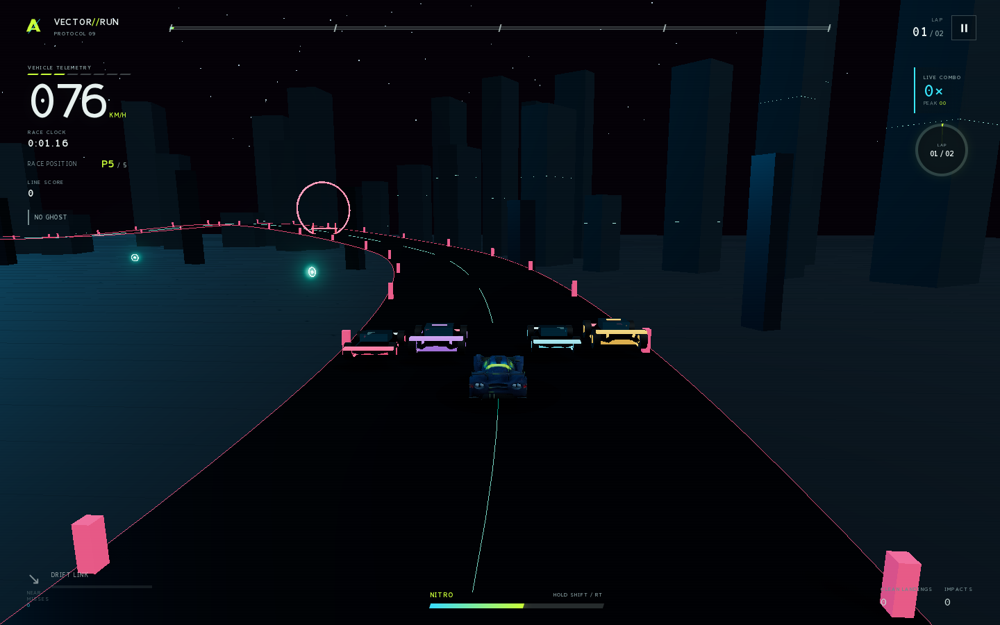

# VECTOR//RUN

**Take the throttle. Own the line.**

VECTOR//RUN is a driver-controlled 3D stunt racer built as a neon night-arcade experience. Choose a chassis and a branching circuit, then race four local rivals through elevated routes, timed gates, jumps and drift lines. Every run begins at a complete stop: the car only moves when you ask it to.



> **Three circuits · Three chassis · Four local rivals · Zero auto-drive**

## Play

Start the game and choose a circuit, car, route and race format in the landing-page race panel. Select **Enter the grid** when you're ready. The opening screen keeps a compact control guide beside the race setup, so you can see how to drive before launching.

| Control | Action |
| --- | --- |
| **Hold W / ↑** | Accelerate from a full stop |
| **Hold S / ↓** | Brake; release to coast down |
| **A / D** or **← / →** | Steer across the road |
| **Mouse: click and drag on the track** | Steer in the drag direction; release to recenter |
| **Hold F** (or **J**) while steering | Drift and build a combo |
| **Hold Shift** (or controller **RT**) while throttling | Spend nitro |
| **Space** / controller **A** | Jump |
| **Esc / P** / controller **Start** | Pause |
| **Touch** | Drag the virtual wheel up for throttle, down to brake, sideways to steer; use the race buttons for boost, drift and jump |

Arrow keys and the pointer-drag option are available alongside the visible W/A/S/D quick-start. Steering assist eases an unsteered car toward the center; it never adds throttle.

## The grid

- **Three selectable cars:** VECTOR VXR (balanced), SPECTRE GT (top speed) and RAPTOR X (launch and grip). Car choice is saved locally.
- **Four local rivals:** a five-car field with overtakeable AI opponents, live race position and finish standings. There is no account, server leaderboard or network multiplayer.
- **Three circuits:** Vanta Crown, Mirage Grid and Abyssal Run. Each has Highline and Undercut routes, vertical branches and timed hazards.
- **Three race formats:** Sprint, Time Attack and Drift Cup.
- **Stunt-racing mastery:** link drifts, jumps, clean landings and near-misses into combos; earn medals, chase personal records and race a personal-best ghost.
- **Driver options:** steering sensitivity, return-to-line assist, audio, reduced camera motion and render quality.



## Run locally

Requires Node.js and pnpm. From the project folder:

```bash
pnpm install --frozen-lockfile
pnpm typecheck
pnpm test
pnpm build
PORT=3000 HOST=0.0.0.0 pnpm dev
```

The app runs in a WebGL-capable browser. `pnpm smoke` runs the Playwright desktop and mobile interaction walkthrough after the production build. Personal records, medals, settings, car preference and ghost traces stay in local browser storage. The registered VXR model and custom favicon are included in the downloadable source bundle.

Pull requests and pushes to `main` run GitHub Actions for type-checking, unit tests and the size-checked source build.

## Project map

| Path | Responsibility |
| --- | --- |
| `src/game/course.ts` | Spline circuits, branching routes, track geometry and timed hazards |
| `src/game/game.ts` | Fixed-step racing, manual movement, camera, race flow and personal ghosts |
| `src/game/rivals.ts` | Local AI cars, course following, race position and finish standings |
| `src/game/vehicles.ts` | Selectable handling profiles and procedural vehicle bodies |
| `src/ui/landing.ts` | Arcade landing screen, race setup and quick-start controls |
| `src/ui/ui.ts` | UI state, input actions, race HUD, settings and results |
| `src/styles/main.css` | Neon visual system, landing layout, HUD and responsive touch presentation |
| `src/engine/input.ts`, `src/ui/touch.ts` | Keyboard, gamepad, pointer-drag and virtual-wheel inputs |
| `src/engine/save.ts` | Versioned local settings, vehicle choice, records and ghosts |
| `scripts/package-source.mjs` | Reproducible, secret-safe source ZIP builder |
| `tests/`, `scripts/smoke.mjs` | Rules, save, course, car, rival and browser interaction coverage |

## License
The VXR is the registered GLB vehicle; the additional car styles and rival bodies use project-owned Three.js geometry. The soundtrack and race cues are synthesized locally. Three.js is MIT-licensed; the bundled ManusCC0 fonts are CC0 1.0.
